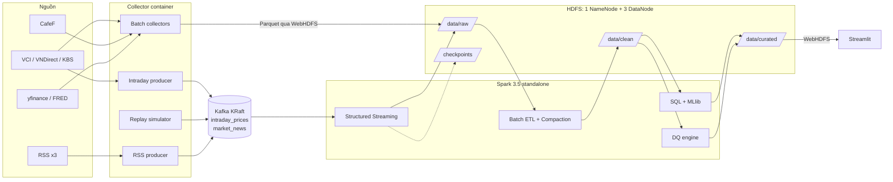

# Implementation Plan — Đồ án môn học Công nghệ dữ liệu lớn

**Đề tài:** Hệ thống dữ liệu lớn Kafka–Spark–HDFS thu thập, truyền tải và lưu trữ dữ liệu thị trường chứng khoán Việt Nam, ứng dụng phân tích sơ bộ xu hướng giá.

- **Nhóm:** Hồng Dương (nhóm trưởng), Hùng Dương (quản lý PC), Tuyền, Thanh
- **Thời gian:** 22/11/2026 → hạn nộp dự kiến 22/12/2026
- **Repo:** `git@github.com:hongduong/big_data_project.git`
- **Nơi chạy:** 1 PC chung Ubuntu native (Ryzen 7 3800X, 32GB RAM), truy cập qua SSH
- **Trạng thái:** kế hoạch đã duyệt 24/11/2026. Bắt đầu Lát 0 từ 24/11. Prompt gốc (do Hùng Dương soạn) lưu ở `Planning_prompt_goc.md`.

Thay đổi so với prompt gốc: bỏ thư viện vnstock (mục 0), 3 DataNode thay vì 2, bảng tài nguyên mới có chỗ cho Spark driver, quy ước git đơn giản hơn (nhánh `develop`, không PR), phạm vi chia bắt buộc / mở rộng.

---

## 0. Kết quả thử nguồn dữ liệu (22/11/2026)

Thử trên máy Mac, không có tài khoản nào, với các mã FPT, VNM, VCB và VNINDEX.

### 0.1 vnstock không dùng được

- Gói `vnstock`, `vnstock3` và `vnai` đều không còn cài được từ PyPI (trang chỉ mục trả 404 hoặc không có bản nào).
- Bản 3.5.0 cài từ GitHub chính thức thì import lỗi vì bắt buộc cần gói `vnai`, mà `vnai` không còn trên PyPI.
- Bản 6 yêu cầu tự đăng ký tài khoản với từng nguồn (SSI, DNSE, TCBS, FHSC). Chưa thử vì bước dưới đã đủ.

**Quyết định:** collector gọi thẳng các endpoint JSON công khai mà vnstock 3.x từng dùng, chỉ cần thư viện `requests`. Không phụ thuộc vnstock.

### 0.2 Các nguồn đã gọi được (không cần tài khoản)

| Dữ liệu | Nguồn | Kết quả đo được |
|---|---|---|
| Nến ngày | VCI (`trading.vietcap.com.vn`) | Lùi tới ngày niêm yết: FPT 12/2006, VNM 01/2006, VCB 06/2009, VNINDEX 01/2004. Giá **đã điều chỉnh**, đơn vị đồng. 0,3–1 giây/request |
| Nến ngày | VNDirect finfo (`api-finfo.vndirect.com.vn`) | Từ 02/01/2013. Có **cả giá gốc lẫn giá điều chỉnh** (`close`, `adClose`), đơn vị nghìn đồng |
| Nến ngày | KBS (`kbbuddywts.kbsec.com.vn`) | Chỉ khoảng 10 năm gần nhất (FPT từ 09/2016), giá điều chỉnh |
| Nến 1 phút | VCI | Lùi tới **11/09/2023**, khoảng 178.000 dòng/mã, 30.000 dòng mỗi request (6–7 request/mã) |
| Nến 1 phút | VNDirect dchart | FPT từ 11/2021 nhưng chỉ 35.000 dòng, thưa hơn VCI |
| Nến 1 phút | KBS | Khoảng 3 tháng gần nhất (14.460 dòng) |
| Khối ngoại theo mã, theo ngày | VNDirect finfo `foreigns` | Từ **30/08/2018**, có cả mã `VNINDEX` (toàn sàn). Trả về mua/bán/ròng theo khối lượng và giá trị |
| Khối ngoại theo mã, theo ngày | CafeF (endpoint JSON) | Có dữ liệu 2007, 2010, 2015. Mỗi request tối đa 30 dòng và cửa sổ khoảng 1 năm, nên chậm khi lấy nhiều mã |
| Danh sách mã | VCI `getAll`, VNDirect `stocks` | HOSE 412 mã, HNX 299, UPCOM 808 |
| Sự kiện doanh nghiệp | VNDirect finfo `events` | FPT có 148 sự kiện, có `disclosureDate` |
| Tin tức RSS | CafeF, Vietstock, VnExpress | Cả 3 trả về 20–60 tin, có `pubDate` |
| Vĩ mô thế giới | yfinance | `^TNX`, `DX-Y.NYB`, `BZ=F`, `^GSPC`, `^VIX`, `VND=X` đều có từ 01/2015 (~2.990 dòng mỗi chuỗi) |
| Vĩ mô thế giới | FRED `fredgraph.csv` | Lấy được DGS10 không cần khoá API. Lần thử đầu bị timeout 30 giây, lần hai được |

### 0.3 Giá điều chỉnh

Ngày 05/01/2015, FPT: VCI trả 6.489,7 đồng; VNDirect trả `adClose` 6,49 (nghìn đồng) và `close` gốc 47,8. Hai nguồn khớp nhau về giá điều chỉnh. CafeF cho giá điều chỉnh 7,86 ngày 30/12/2015, tức cách điều chỉnh của CafeF khác hai nguồn kia; đây là dữ liệu thật cho kiểm tra đối chiếu chéo.

### 0.4 Tốc độ và giới hạn

- 40 request liên tiếp tới VCI (1,9 giây) và VNDirect (0,5 giây) đều trả 200, không bị chặn.
- **Chưa thử ở quy mô đầy đủ** (hàng nghìn request). Collector sẽ tự giới hạn ≤ 2 request/giây mỗi nguồn và có retry + backoff.
- Ước tính tải đầy đủ: nến ngày 412 mã ≈ 412 request; nến phút 412 mã ≈ 2.900 request (khoảng 30–60 phút); khối ngoại VNDirect ≈ 1.000 request.

### 0.5 Rủi ro còn lại của nguồn

- Đây là endpoint nội bộ của web các công ty chứng khoán, không phải API có cam kết. Có thể đổi hoặc chặn bất cứ lúc nào. Giảm rủi ro bằng chuỗi nguồn dự phòng và tải toàn bộ lịch sử sớm (lát cắt 2), lưu ở lớp `raw`.
- Dữ liệu chỉ dùng cho học tập, không phân phối lại.

---

## 1. Phạm vi

### 1.1 Bắt buộc

| Nhóm | Nội dung | Quy mô ước tính |
|---|---|---|
| Batch — giá ngày | 412 mã HOSE + VNINDEX, VN30 từ 2015. Chính: VCI. Dự phòng và đối chiếu: VNDirect | ~1,1 triệu dòng |
| Batch — khối ngoại | Theo mã và toàn sàn từ 30/08/2018 (VNDirect). Riêng VNINDEX và rổ VN30 lấy thêm 2015–2018 từ CafeF | ~0,9 triệu dòng |
| Batch — hồ sơ | Danh sách mã, sàn, ngành, ngày niêm yết (VCI, VNDirect) | ~1.500 dòng |
| Batch — vĩ mô | US 10Y, DXY, Brent, S&P 500, VIX, USD/VND từ 2015 (yfinance; FRED để đối chiếu) | ~18.000 dòng |
| Streaming — giá phút | Topic `intraday_prices`. Lịch sử 1 phút từ 09/2023 (VCI) phát lại qua Replay Simulator; trong giờ giao dịch có collector lấy nến phút mới | Tải theo 2 đợt: **đợt 1 rổ VN30** (~5 triệu dòng, ~200 request) là mức tối thiểu; **đợt 2 phần còn lại của 412 mã** (tổng ~60–70 triệu dòng) chỉ chạy khi đợt 1 ổn |
| Streaming — tin tức | Topic `market_news` từ 3 RSS. Chỉ thu và lưu, không phân tích nội dung | vài trăm tin/ngày |
| Chất lượng dữ liệu | 5 nhóm: Completeness, Uniqueness, Validity, bước nhảy giá bất thường, đối chiếu chéo VCI ↔ VNDirect | — |
| Phân tích | Spark SQL (toàn sàn, độ rộng, thanh khoản, khối ngoại); Logistic Regression T+5 + leakage test; Streamlit | — |
| Benchmark | Storage, Streaming, Fault tolerance, Scale-out, tổng hợp DQ/ML | — |

Hai thay đổi so với bảng đề xuất trước nhờ kết quả mục 0: đối chiếu chéo lên phần bắt buộc (VNDirect có API JSON, không phải scrape), và scale-out lên phần bắt buộc (dữ liệu phút thật đã đủ lớn).

### 1.2 Mở rộng (chỉ làm khi phần bắt buộc xong)

- HNX và UPCOM (thêm ~1.100 mã).
- Khối ngoại 2015–2018 cho toàn bộ mã qua CafeF.
- Lịch sự kiện: sự kiện doanh nghiệp (VNDirect `events`), đáo hạn phái sinh, cơ cấu ETF, họp Fed.
- CafeF làm nguồn đối chiếu thứ ba.
- Phân tích nội dung tin tức; thêm mô hình ngoài Logistic Regression.

---

## 2. Kiến trúc và phân bổ tài nguyên

### 2.1 Luồng dữ liệu



### 2.2 Container và tài nguyên

Ngân sách: ≤ 26GB RAM, ≤ 14 vCPU. Tổng dùng: **24,5GB / 14 vCPU** (spark-driver nâng từ 2GB / 1 CPU lên 3GB / 2 CPU ngày 24/11/2026 sau số đo Lát 1).

| Container | Số lượng | `mem_limit` | `cpus` | JVM heap / cấu hình |
|---|---|---|---|---|
| Kafka (KRaft, 1 broker kiêm controller) | 1 | 2GB | 2 | `KAFKA_HEAP_OPTS=-Xms1g -Xmx1g` |
| HDFS NameNode | 1 | 1,5GB | 1 | `HDFS_NAMENODE_OPTS=-Xmx1g` |
| HDFS DataNode | 3 | 1GB | 0,5 | `HDFS_DATANODE_OPTS=-Xmx512m` |
| Spark Master | 1 | 1GB | 0,5 | `SPARK_DAEMON_MEMORY=512m` |
| Spark Worker | 3 | 4GB | 2 | `SPARK_WORKER_CORES=2`, `SPARK_WORKER_MEMORY=3g`, `spark.executor.memory=3g` |
| Spark driver (streaming / batch) | 1 | 3GB | 2 | `spark.driver.memory=1400m` |
| Collector / Scheduler | 1 | 1GB | 0,5 | Python |
| Streamlit | 1 | 1GB | 0,5 | Python |

**Số đo thật bằng `docker stats` trên PC (24/11/2026, 3 worker):**

| Container | Giới hạn | Lúc rỗi | Khi chạy job thử |
|---|---|---|---|
| Kafka | 2GB | 315MB (15%) | 315MB (15%) |
| NameNode | 1,5GB | 433MB (28%) | 435MB (28%) |
| DataNode 1 / 2 / 3 | 1GB mỗi node | 314 / 321 / 316MB (~31%) | 340 / 354 / 340MB (~34%) |
| Spark Master | 1GB | 251MB (25%) | 253MB (25%) |
| Spark Worker 1 / 2 / 3 | 4GB mỗi worker | 229 / 199 / 203MB (~5%) | 2,55 / 2,06 / 1,86GB (64% / 51% / 47%) |
| Spark driver | 2GB | 2MB (chưa có job) | 579MB (28%) |
| Collector | 1GB | 1MB | 1MB |
| Streamlit | 1GB | 54MB (5%) | 53MB (5%) |

- Job thử: PySpark sinh 30 triệu dòng, sắp xếp, ghi Parquet lên HDFS (2,3GB), gom nhóm rồi đọc lại; chạy 68 giây trên cả 3 executor. Không container nào bị OOM kill.
- Host: RAM thực tế 31.013MB. Lúc rỗi còn `available` 23.190MB; thấp nhất khi chạy job là 16.454MB.
- Tổng giới hạn (lúc đo là 23,5GB, nay 24,5GB) chỉ là trần; mức dùng thật lúc rỗi khoảng 3GB, khi chạy job thử khoảng 9GB.
- **Chưa đo:** job có Python UDF hoặc pandas (tiến trình Python nằm ngoài heap 3GB của executor) và collector khi tải dữ liệu thật (Lát 2).

**Số đo Lát 1: streaming chạy song song batch (24/11/2026, dữ liệu mẫu, 3 worker).** Job streaming `intraday_to_raw` (processingTime 10 giây, `spark.cores.max=2`) chạy liên tục; cùng lúc phát lại 11.259 bản tin (5 ngày, 2.000 msg/giây) và gửi hai job `daily_raw_to_clean`, `intraday_raw_to_clean`. `docker stats` lấy mẫu khoảng 6 giây một lần (42 mẫu trong 4 phút, nên có thể lỡ đỉnh ngắn).

| Container | Giới hạn | Trung vị | Đỉnh | CPU đỉnh |
|---|---|---|---|---|
| Spark Worker 1 / 2 / 3 | 4GB mỗi worker | 282 / 285 / 492MB | 911 / 891 / 983MB (~24%) | 205% / 196% / 213% |
| Spark driver (3 driver cùng lúc) | 2GB | 455MB | 1.562MB (76%) | 105% |
| Kafka | 2GB | 745MB | 754MB | 12% |
| NameNode | 1,5GB | 555MB | 556MB | 7% |
| DataNode 1 / 2 / 3 | 1GB mỗi node | 377 / 411 / 402MB | 388 / 415 / 404MB | ≤ 5% |
| Spark Master | 1GB | 271MB | 276MB | 6% |
| Collector (đang replay) | 1GB | 2MB | 34MB | 15% |
| Streamlit | 1GB | 53MB | 64MB | 19% |

- Chia core trên master: streaming 2 core (1 executor, worker3); `daily_raw_to_clean` lấy 4 core còn lại (worker1, worker2); `intraday_raw_to_clean` ở trạng thái WAITING khoảng 35 giây cho tới khi job daily xong rồi mới nhận 4 core. Hai job batch không chạy song song với nhau vì job batch không đặt `spark.cores.max`.
- Host `available` thấp nhất 18.713MB. Không container nào bị OOM kill hay khởi động lại; log worker/master không có executor bị mất.
- Đánh giá: worker còn dư nhiều (đỉnh < 1GB / 4GB với dữ liệu mẫu). Driver là chỗ chật: mỗi spark-submit là một JVM `-Xmx1400m` trong cùng container 2GB và 1 CPU; ba driver cùng lúc đã lên 1,56GB và dùng hết 1 CPU (batch đầu tiên của streaming mất 23 giây cho 11.259 dòng). Không nên chạy quá 3 driver cùng lúc trong `spark-driver`.
- **Sau số đo này** container `spark-driver` được nâng lên 3GB / 2 CPU. Các số ở bảng trên đo với giới hạn cũ 2GB / 1 CPU; chưa đo lại 3 driver cùng lúc với giới hạn mới.
- Latency đầu-cuối của lần phát lại này (commit của batch − `produced_ts`): p50 28,1 giây, p95 30,7 giây; gồm thời gian chờ trigger 10 giây và batch 23 giây khi tranh CPU với hai job batch.
- Job streaming đặt `spark.cores.max=2` để không chiếm hết executor của job batch.
- Khi chạy benchmark scale-out và storage thì dừng job streaming.
- Dùng Compose `profiles` (`w1`, `w2`, `w3`) để bật 1, 2, 3 worker.

### 2.3 Image, cổng, volume

| Thành phần | Image (amd64) | Cổng host | Volume |
|---|---|---|---|
| Kafka | `apache/kafka` 3.9.x | 9094 | `kafka_data` |
| NameNode | `apache/hadoop` 3.3.6 | 9870 (UI + WebHDFS), 8020 | `nn_data` |
| DataNode 1–3 | `apache/hadoop` 3.3.6 | 9864–9866 | `dn1_data`, `dn2_data`, `dn3_data` |
| Spark Master | image `spark` tự build (xem dưới) | 8080, 7077 | — |
| Spark Worker 1–3 | image `spark` tự build | 8081–8083 | — |
| Spark driver | image `spark` tự build | 4040 | — |
| Collector | image tự build từ `python:3.11-slim` + `stocklake[collector]` | — | `collector_state` |
| Streamlit | image tự build từ `python:3.11-slim` + `stocklake[dashboard]` | 8501 | — |

Image `spark` build từ `apache/spark` 3.5.x, cài thêm `stocklake[spark]` và chép `jobs/`. Master, worker và driver dùng chung image này để executor thấy cùng một bản code.

**Tag đã chốt (pull và chạy được trên PC 24/11/2026), ghim trong `.env.example` và `docker-compose.yml`:**

| Image | Tag | Ghi chú |
|---|---|---|
| Spark | `apache/spark:3.5.9-scala2.12-java17-python3-ubuntu` | Java 17, Python 3.10.12 cho cả driver và executor |
| Kafka | `apache/kafka:3.9.2` | Java 21 |
| Hadoop | `apache/hadoop:3.3.6` | Java 8 |
| Python | `python:3.11-slim` | Collector và Streamlit chạy Python 3.11 |

Bốn jar của `spark-sql-kafka-0-10_2.12:3.5.9` được tải sẵn vào image `spark` lúc build, nên lúc gửi job không cần Internet. Đổi phiên bản Spark thì phải đổi theo.

Image `spark` dùng Python 3.10 còn collector và Streamlit dùng 3.11; vì vậy `pyproject.toml` đặt `requires-python >= 3.10`.

### 2.4 Cấu hình HDFS đã chỉnh

| Tham số | Giá trị | Mặc định | Lý do |
|---|---|---|---|
| `dfs.replication` | 2 | 3 | Theo đề bài |
| Số DataNode | 3 | — | Khi 1 node chết, NameNode còn node thứ ba để tự nhân bản lại |
| `dfs.namenode.heartbeat.recheck-interval` | 15000 ms | 300000 ms | Rút thời gian phát hiện node chết |
| `dfs.heartbeat.interval` | 1 s | 3 s | Như trên |

Thời gian NameNode coi một DataNode là chết = 2 × recheck + 10 × heartbeat = **40 giây** (mặc định 630 giây). Báo cáo phải ghi rõ đây là giá trị đã chỉnh cho bài đo.

### 2.5 Giới hạn đã biết

- **Kafka 1 broker:** không có chịu lỗi ở tầng broker. Bài đo fault tolerance chỉ kill phía consumer (job Spark Streaming).
- **Một máy vật lý:** mọi container dùng chung CPU, RAM và một ổ NVMe. Kết quả scale-out và chịu lỗi là minh hoạ cơ chế, không đại diện cho cụm nhiều máy.
- **3 DataNode chung một ổ đĩa:** nhân bản không tăng độ bền dữ liệu thật.

---

## 3. Cấu trúc repo và quy ước git

### 3.1 Cây thư mục và vùng sở hữu

Sơ đồ duyệt: `repo_structure.html` (duyệt 24/11/2026). Tên package `stocklake`.

```
big_data_project/
├── docker-compose.yml          # Hùng Dương — profiles w1, w2, w3
├── Makefile                    # Hùng Dương
├── pyproject.toml              # Hùng Dương — 1 package; nhóm phụ thuộc spark, collector, dashboard, dev
├── .env.example                # Hùng Dương
├── docker/                     # Hùng Dương — build context là gốc repo
│   ├── spark/Dockerfile        #   master, worker, driver; cài stocklake[spark]
│   ├── collector/Dockerfile    #   cài stocklake[collector]
│   └── dashboard/Dockerfile    #   cài stocklake[dashboard]
├── conf/                       # Hùng Dương
│   ├── hadoop/                 #   core-site.xml, hdfs-site.xml
│   ├── kafka/                  #   cấu hình KRaft, script tạo topic
│   ├── spark/                  #   spark-defaults.conf
│   └── app/                    #   danh sách mã, nguồn, tốc độ gọi (YAML)
├── src/stocklake/              # toàn bộ logic, cài bằng pip
│   ├── contracts/              # dùng chung — sửa phải báo cả nhóm
│   │   ├── schemas.py          #   schema trung lập, Python thuần, cho mọi bảng và topic
│   │   ├── convert.py          #   to_spark(), to_arrow(); import pyspark/pyarrow bên trong hàm
│   │   ├── topics.py
│   │   ├── paths.py            #   đường dẫn HDFS 3 lớp
│   │   └── available_at.py     #   quy tắc mục 4.1
│   ├── common/                 # Hùng Dương
│   │   └── config.py, spark.py, hdfs.py, logging.py,
│   │       http.py             #   retry, backoff, giới hạn tốc độ dùng chung
│   ├── sources/                # Hồng Dương — client gọi nguồn + phân tích kết quả
│   │   └── vci, vndirect, kbs, cafef, yahoo, fred, rss
│   ├── ingestion/              # Hồng Dương
│   │   ├── framework/          #   base collector, fallback, state idempotent
│   │   └── collectors/         #   collector batch: nến ngày, khối ngoại, hồ sơ, vĩ mô
│   ├── streaming/              # Tuyền
│   │   ├── producers/          #   intraday, rss, replay (gọi nguồn qua sources)
│   │   └── sinks/              #   Kafka → raw
│   ├── etl/                    # Hùng Dương
│   │   ├── raw_to_clean/
│   │   └── compaction/
│   ├── dq/                     # Hồng Dương
│   │   ├── checks/             #   5 nhóm kiểm tra
│   │   └── report.py
│   └── analytics/              # Thanh
│       ├── curated/            #   bảng tổng hợp, bảng feature
│       ├── sql/
│       └── ml/                 #   baseline, leakage test
├── jobs/                       # điểm vào mỏng; chủ theo module tương ứng
│   ├── ingest/                 # Hồng Dương
│   ├── streaming/              # Tuyền
│   ├── etl/                    # Hùng Dương
│   ├── dq/                     # Hồng Dương
│   └── analytics/              # Thanh
├── dashboard/                  # Thanh — app.py, pages/
├── benchmarks/
│   ├── storage/                # Hùng Dương
│   ├── scaleout/               # Hùng Dương
│   ├── fault_tolerance/        # Hùng Dương (DataNode, Worker), Tuyền (consumer)
│   ├── streaming/              # Tuyền
│   ├── summary/                # Thanh
│   └── results/                # CSV/JSON/PNG, có commit
├── tests/
│   ├── unit/                   # không cần cụm; test dùng Spark local đánh dấu `spark`
│   ├── integration/            # cần cụm, chạy trên PC
│   └── fixtures/               # mẫu JSON thật của từng nguồn
├── docs/                       # cả nhóm — Planning.md, runbook.md, adr/ (mức tối thiểu)
│   └── data_dictionary.md      #   sinh từ schema trung lập bằng `make docs`
└── .github/workflows/ci.yml    # tuỳ chọn, mức tối thiểu: ruff + pytest không cần Spark
```

Nguyên tắc:

- **Một package cài được.** Collector, Spark driver, executor, dashboard và test đều import cùng một bản `stocklake`. Wheel được cài sẵn vào cả 3 image.
- **Mỗi image chỉ cài nhóm phụ thuộc của mình.** `pyproject.toml` chia 4 nhóm:
  - `stocklake[spark]`: thư viện job cần trên driver và executor (`pyarrow`, `numpy`). Không kéo `pyspark`, vì image `apache/spark` đã có sẵn.
  - `stocklake[collector]`: `requests`, `yfinance`, `feedparser`, client Kafka, `pyarrow`.
  - `stocklake[dashboard]`: `streamlit`, `fsspec`, `pyarrow`, `pandas`.
  - `dev`: `pytest`, `ruff`, và `pyspark` ghim cùng phiên bản với image.
- **Schema trung lập.** `contracts/schemas.py` khai báo bằng Python thuần: tên cột, kiểu, nullable, khoá chính, mô tả. `contracts/convert.py` chuyển sang `StructType` của Spark và schema của pyarrow; `pyspark` và `pyarrow` chỉ được import bên trong hàm chuyển, không import ở đầu file. Nhờ vậy collector và dashboard import `contracts` mà không cần cài pyspark.
- **Điểm vào mỏng.** File trong `jobs/` chỉ đọc tham số rồi gọi một hàm trong `stocklake`. Logic là hàm nhận và trả DataFrame nên test được bằng Spark local.
- **Quy tắc phụ thuộc.**
  - `ingestion`, `streaming`, `etl`, `dq`, `analytics` không import lẫn nhau; chỉ phụ thuộc `contracts`, `common` và `sources`. Chúng nối với nhau qua Kafka và HDFS.
  - `sources` chỉ chứa client gọi nguồn và phân tích kết quả trả về; chỉ phụ thuộc `contracts` và `common`.
  - `common` chỉ phụ thuộc `contracts`. `contracts` không phụ thuộc module nào.
  - Retry, backoff và giới hạn tốc độ nằm ở `common/http.py`, dùng chung cho mọi client trong `sources`.
- **Cấu hình và dữ liệu ở ngoài code.** Tham số ứng dụng ở `conf/app/`, bí mật ở `.env` (không commit). Dữ liệu chỉ nằm trên HDFS; git chỉ giữ `benchmarks/results/`.
- Mỗi thư mục một chủ, riêng `contracts/` là dùng chung.

Ghi chú khi làm:

- **Mount code khi phát triển.** Để khỏi build lại image, mount `src/` và `jobs/` vào container. Phải mount cho cả 3 Spark worker lẫn driver; nếu chỉ driver thấy code mới thì executor vẫn chạy bản cũ trong wheel.
- **Unit test cần Spark.** Test dùng Spark local cần Java và `pyspark`. Máy cá nhân ít đĩa thì chạy nhóm này trên PC; test không cần Spark (schema, client nguồn với fixtures) chạy được ở bất kỳ đâu.
- **Phần phụ để mức tối thiểu.** `docs/adr/`, `docs/runbook.md` và `.github/workflows/ci.yml` chỉ làm mức tối thiểu cho tới khi phần bắt buộc xong.

| Thành viên | Vai trò | Vùng sở hữu |
|---|---|---|
| Hùng Dương (quản lý PC) | Hạ tầng, HDFS, Spark ETL | `docker-compose.yml`, `Makefile`, `pyproject.toml`, `docker/`, `conf/`, `stocklake/common`, `stocklake/etl`, `jobs/etl`, `benchmarks/storage`, `scaleout`, `fault_tolerance` |
| Hồng Dương (nhóm trưởng) | Thu thập và chất lượng dữ liệu | `stocklake/sources`, `stocklake/ingestion`, `stocklake/dq`, `jobs/ingest`, `jobs/dq` |
| Tuyền | Kafka và streaming | `stocklake/streaming`, `jobs/streaming`, `benchmarks/streaming`, kịch bản kill consumer |
| Thanh | Phân tích và giao diện | `stocklake/analytics`, `jobs/analytics`, `dashboard/`, `benchmarks/summary` |

### 3.2 Quy ước git

- `develop` là nhánh tích hợp. Mỗi phần việc làm trên feature branch tách từ `develop`, đặt tên `feat/<vùng>-<mô-tả>` (ví dụ `feat/ingestion-daily-ohlcv`). Xong thì merge thẳng vào `develop`, không cần PR.
- **Không đụng nhánh `main`:** không commit, không merge, không push. Hồng Dương tự merge tay khi cần.
- Mỗi commit chỉ thuộc phần của một thành viên và chỉ chạm vùng sở hữu của người đó.
- Commit message: `[<Tên thành viên>] <vùng>: <nội dung>`, ví dụ `[Tuyền] streaming: thêm replay simulator`. Không có dòng `Co-Authored-By`.
- Sau khi dự án ổn, từng thành viên tự pick commit của mình và sửa thông tin tác giả.
- Thay đổi `src/stocklake/contracts/` commit riêng, ghi tên người đề xuất.
- Thêm hay đổi thư viện trong `pyproject.toml` cũng commit riêng (vùng của Hùng Dương), không gộp vào commit của module cần thư viện đó.

---

## 4. Data contracts

Quy ước chung: giờ lưu dạng `timestamp` UTC; `trade_date` là ngày theo giờ Việt Nam; giá cổ phiếu đơn vị **đồng** (VNDirect trả nghìn đồng, nhân 1.000 ở lớp `clean`).

Các schema dưới đây được khai báo một lần ở `src/stocklake/contracts/schemas.py` dưới dạng trung lập; Spark và pyarrow lấy schema qua `contracts/convert.py`.

Mọi bảng `raw` có 3 cột metadata: `source` (string, not null), `ingest_ts` (timestamp, not null), `available_at` (timestamp, not null).

### 4.1 Quy tắc `available_at`

| Loại dữ liệu | `available_at` |
|---|---|
| Nến ngày của ngày D | D 15:30 giờ VN (sau phiên ATC 14:45) |
| Khối ngoại của ngày D | D 18:00 giờ VN |
| Nến 1 phút bắt đầu lúc t | t + 1 phút |
| Tin tức | `pubDate` của tin |
| Vĩ mô từ yfinance, phiên D (giờ Mỹ) | D+1 08:00 giờ VN |
| Vĩ mô từ FRED, ngày D | D+2 08:00 giờ VN (FRED công bố trễ một ngày làm việc) |
| Hồ sơ doanh nghiệp | bằng `ingest_ts`. Là ảnh chụp hiện tại, không dùng làm feature lịch sử |
| Sự kiện doanh nghiệp (mở rộng) | `disclosureDate` |

Lưu ý: giá điều chỉnh được tính lùi bằng các sự kiện xảy ra sau này. Feature chỉ dùng tỷ suất sinh lời và tỷ lệ; không dùng mức giá điều chỉnh tuyệt đối.

### 4.2 Kafka topics

**`intraday_prices`** — key = `symbol`, 6 partition, JSON

| Trường | Kiểu | Null | Ghi chú |
|---|---|---|---|
| `symbol` | string | không | |
| `bar_ts` | long (epoch ms) | không | Thời điểm mở nến |
| `open`, `high`, `low`, `close` | double | không | Đồng |
| `volume` | long | không | |
| `source` | string | không | `vci`, `vndirect`, `kbs`, `replay` |
| `produced_ts` | long (epoch ms) | không | Lúc producer gửi, dùng đo latency |
| `available_at` | long (epoch ms) | không | |
| `replay_run_id` | string | có | Chỉ có khi phát lại |

Khoá khử trùng: (`symbol`, `bar_ts`, `source`).

**`market_news`** — key = `news_id`, 1 partition, JSON

| Trường | Kiểu | Null | Ghi chú |
|---|---|---|---|
| `news_id` | string | không | SHA-1 của `link` |
| `feed` | string | không | `cafef`, `vietstock`, `vnexpress` |
| `title`, `link` | string | không | |
| `summary` | string | có | |
| `published_ts` | long (epoch ms) | không | |
| `produced_ts`, `available_at` | long (epoch ms) | không | |

Khoá khử trùng: `news_id`.

### 4.3 Lớp `raw` (`/data/raw/...`)

| Bảng | Khoá | Cột chính | Phân vùng |
|---|---|---|---|
| `daily_ohlcv` | `symbol`, `trade_date`, `source` | `open`, `high`, `low`, `close` (double, đơn vị gốc của nguồn), `volume` (long), `raw_close` (double, null nếu nguồn không có), `price_unit` (string) | `source`, `year` |
| `foreign_flow` | `symbol`, `trade_date`, `source` | `buy_vol`, `sell_vol`, `net_vol` (long), `buy_val`, `sell_val`, `net_val` (double), `room_left` (double, null) | `source`, `year` |
| `company_profile` | `symbol`, `snapshot_date` | `exchange`, `company_name`, `icb_code`, `listed_date` | `snapshot_date` |
| `macro_daily` | `series_id`, `obs_date`, `source` | `value` (double) | `source` |
| `intraday_prices` | như topic | như topic + `kafka_partition`, `kafka_offset`, `kafka_ts`, `spark_batch_ts` | `trade_date` |
| `market_news` | như topic | như topic + cột Kafka | `ingest_date` |

Batch collector ghi `raw` theo từng lô, đặt tên file theo (`source`, `symbol` hoặc `series`, khoảng ngày). Chạy lại thì ghi đè đúng file đó, nên không tạo trùng.

### 4.4 Lớp `clean` (`/data/clean/...`)

| Bảng | Khoá chính | Cột | Phân vùng |
|---|---|---|---|
| `daily_ohlcv` | `symbol`, `trade_date` | `open`, `high`, `low`, `close` (double, đồng, đã điều chỉnh), `raw_close` (double, null), `volume` (long), `source` (nguồn được chọn), `available_at`, `dq_flags` (array<string>) | `year` (sắp xếp theo `symbol`) |
| `foreign_flow` | `symbol`, `trade_date` | như raw, đã chuẩn hoá kiểu | `year` |
| `company_profile` | `symbol` | bản mới nhất | không |
| `macro_daily` | `series_id`, `obs_date` | `value`, `available_at` | không |
| `intraday_1m` | `symbol`, `bar_ts` | OHLCV, `trade_date`, `available_at` | `year`, `month` (sắp xếp theo `symbol`) |
| `market_news` | `news_id` | như raw, đã khử trùng | `year`, `month` |
| `trading_calendar` | `trade_date` | `is_trading_day` (suy ra từ VNINDEX) | không |

### 4.5 Lớp `curated` (`/data/curated/...`)

| Bảng | Khoá chính | Nội dung |
|---|---|---|
| `market_daily` | `trade_date` | Số mã tăng/giảm/đứng, tổng khối lượng, tổng giá trị, khối ngoại ròng toàn sàn, VNINDEX |
| `symbol_daily_features` | `symbol`, `trade_date` | Tỷ suất 1/5/20 ngày, biến động 20 ngày, tỷ lệ khối lượng so với trung bình 20 ngày, khối ngoại ròng 5 ngày, biến động vĩ mô, `feature_available_at` (lớn nhất của các `available_at` đầu vào), `label_up_t5` |
| `dq_report` | `run_id`, `table_name`, `check_name` | `metric_value`, `threshold`, `passed`, `run_ts` |
| `ml_results` | `run_id`, `scenario`, `model` | Accuracy, F1-macro, AUC, khoảng thời gian train/test |
| `benchmark_results` | `suite`, `run_id`, `case` | Số đo và cấu hình |

---

## 5. Các đánh đổi thiết kế

### (a) Phân vùng và small files

- `partitionBy("year", "symbol")` với 412 mã × 12 năm tạo khoảng 4.900 thư mục, mỗi file chỉ vài chục KB. NameNode tốn bộ nhớ cho từng file và Spark tốn thời gian liệt kê. Với 1.600 mã con số là ~19.000.
- **Chọn:** nến ngày phân vùng theo `year`, sắp xếp theo `symbol` trong file để tận dụng thống kê row group của Parquet. Nến phút phân vùng theo `year`, `month`.
- Phương án `year`/`symbol` vẫn được dựng trong bài đo storage làm đối chứng.
- **Compaction:** Structured Streaming ghi danh sách file vào `_spark_metadata`, nên không gom file tại thư mục streaming đang ghi. `raw` do streaming ghi; job batch đọc `raw`, ghi sang `clean` đã gom file. Bài đo trước/sau compaction so `raw` với `clean`.

### (b) Đo end-to-end latency

- Producer ghi `produced_ts` vào từng bản tin.
- Job streaming thêm `spark_batch_ts = current_timestamp()`, giá trị này cố định trong một micro-batch.
- Một `StreamingQueryListener` ghi lại cho mỗi batch: thời điểm bắt đầu và `durationMs.triggerExecution`. Thời điểm commit = bắt đầu + thời lượng.
- Latency của một bản ghi = thời điểm commit của batch chứa nó − `produced_ts`. Tính p50, p95 trên toàn bộ bản ghi.
- Producer và Spark cùng một máy nên không lệch đồng hồ.
- Đo ở nhiều tốc độ phát lại (500, 2.000, 5.000, 10.000 msg/giây) và ghi rõ trigger interval.

### (c) Giữ bài đo công bằng

- **Scale-out:** cố định 2 core + 3GB mỗi executor, cố định `spark.sql.shuffle.partitions`, cùng một bộ dữ liệu, dừng streaming. Mỗi cấu hình chạy 1 lần làm nóng + 5 lần đo, báo trung vị và độ lệch.
- Bộ dữ liệu đo là nến phút thật (mục tiêu 60–70 triệu dòng). Nếu chưa thấy speedup rõ thì nhân bản ×N bằng cách gắn hậu tố vào `symbol`, và ghi rõ hệ số nhân trong báo cáo.
- **Cold / warm read:** trước mỗi lần cold read chạy `sync; echo 3 > /proc/sys/vm/drop_caches` trên host bằng sudo. Page cache là của host nên lệnh này xoá cache cho mọi DataNode container.
- Ghi kèm mỗi kết quả: tag image, cấu hình Spark, số file, dung lượng.

### (d) Leakage test

- Chia tập theo thời gian: train đến hết 2023, validation 2024, test 2025–2026.
- Kịch bản sạch: mọi feature tại ngày t chỉ dùng bản ghi có `available_at ≤ t 15:30`. Có một kiểm tra tự động khẳng định `feature_available_at ≤` thời điểm dự đoán cho mọi dòng.
- Kịch bản cố tình rò rỉ, chạy riêng từng cái: (1) chia ngẫu nhiên thay vì theo thời gian; (2) dùng vĩ mô Mỹ cùng ngày D thay vì D−1; (3) chuẩn hoá feature bằng thống kê của cả tập train lẫn test.
- So sánh Accuracy, F1-macro, AUC của các kịch bản với nhau và với baseline ngây thơ (lớp đa số, persistence). Kỳ vọng mô hình sạch chỉ nhỉnh hơn baseline một chút; kết quả đó vẫn hợp lệ vì trọng tâm là kho dữ liệu.

### (e) Streamlit đọc HDFS

- Đọc qua **WebHDFS** bằng `fsspec` (`webhdfs://namenode:9870`) + `pyarrow`. Không cần cài Java hay libhdfs trong image Streamlit.
- Streamlit chỉ đọc lớp `curated`, các bảng này nhỏ. Container Streamlit nằm cùng mạng Compose để phân giải được tên DataNode khi WebHDFS chuyển hướng.

---

## 6. Lộ trình thực thi

Thực thi theo lát cắt dọc. Mỗi lát kết thúc bằng một trạng thái chạy được trên PC. Cột "Vùng" cho biết commit thuộc về ai.

### Lát 0 — Nền tảng và hạ tầng (24/11 → 27/11)

**Điều kiện:** SSH vào PC đã sẵn sàng từ 24/11 (mục 8, quyết định 2).

| Việc | Vùng |
|---|---|
| Đẩy các file Phase 0 lên `develop` (mục 7) | Hùng Dương, cả nhóm |
| Dựng cụm: Kafka, HDFS 1+3, Spark master + 3 worker | Hùng Dương |
| Chốt tag image, đo `docker stats`, cập nhật bảng 2.2 | Hùng Dương |
| `common/http.py`: retry, backoff, giới hạn tốc độ | Hùng Dương |
| Client VCI đầu tiên trong `sources` | Hồng Dương |
| Khung collector: fallback, state idempotent | Hồng Dương |
| Tạo 2 topic, producer mẫu | Tuyền |
| Khung Streamlit đọc WebHDFS | Thanh |

**Xong khi:**
- `make up && make health` báo mọi container khoẻ.
- `docker exec namenode hdfs dfsadmin -report` thấy 3 DataNode sống.
- `make smoke-kafka` gửi và nhận được 1 bản tin.
- `make smoke-spark` chạy SparkPi trên 3 worker.

### Lát 1 — Chạy thông đầu cuối với dữ liệu mẫu (28/11 → 03/12) — mốc 1/3

Dữ liệu mẫu: 10 mã, 1 năm nến ngày, 5 ngày nến phút.

| Việc | Vùng |
|---|---|
| Client VNDirect trong `sources`; collector nến ngày VCI + dự phòng VNDirect → `raw` | Hồng Dương |
| Replay simulator + intraday producer → Kafka (gọi VCI qua `sources`) | Tuyền |
| Job streaming Kafka → `raw` với checkpoint trên HDFS | Tuyền |
| Job `raw` → `clean` cho nến ngày và nến phút | Hùng Dương |
| Streamlit vẽ biểu đồ giá từ dữ liệu mẫu | Thanh |

**Xong khi:**
- `make e2e-sample` chạy hết không lỗi.
- `hdfs dfs -ls -R /data/raw /data/clean` có file Parquet ở cả hai lớp.
- Số bản ghi replay gửi đi bằng số bản ghi phân biệt ở `raw/intraday_prices`.
- Mở `http://<PC>:8501` thấy biểu đồ.

### Lát 2 — Dữ liệu đầy đủ, làm sạch, chất lượng (04/12 → 10/12)

| Việc | Vùng |
|---|---|
| Client còn lại trong `sources` (KBS, CafeF, yfinance, FRED); tải toàn bộ: nến ngày 412 mã, khối ngoại, hồ sơ, vĩ mô | Hồng Dương |
| Tải lịch sử nến phút từ 09/2023 và phát lại qua Kafka | Tuyền |
| Client RSS trong `sources` | Hồng Dương |
| RSS producer + job streaming tin tức | Tuyền |
| `raw` → `clean` đầy đủ, job compaction, lịch chạy | Hùng Dương |
| DQ engine 5 nhóm, ghi `curated/dq_report` | Hồng Dương |
| Bảng `market_daily`, `symbol_daily_features` | Thanh |

**Xong khi:**
- `make counts` in số dòng từng bảng, đạt mức mục 1.1 (hoặc ghi rõ lý do thiếu).
- Chạy lại `make ingest-daily` hai lần, số dòng `clean` không đổi.
- `make dq` xuất báo cáo đủ 5 nhóm.

### Lát 3 — Phân tích, dashboard, dựng benchmark (11/12 → 16/12)

| Việc | Vùng |
|---|---|
| Spark SQL analytics | Thanh |
| Logistic Regression T+5, baseline ngây thơ, leakage test | Thanh |
| Dashboard hoàn chỉnh: giá, khối ngoại, độ rộng, DQ, ML | Thanh |
| Script benchmark storage, scale-out, kill DataNode, kill worker | Hùng Dương |
| Script benchmark streaming, kill consumer | Tuyền |
| Data dictionary đầy đủ 3 lớp | Hồng Dương |

**Xong khi:**
- `make ml` ghi `curated/ml_results` có đủ kịch bản sạch và rò rỉ.
- Mỗi bộ benchmark chạy thử được một lần bằng `make bench-<tên>` và sinh file trong `benchmarks/results/`.

### Lát 4 — Đo chính thức và đóng gói (17/12 → 20/12), dự phòng 21–22/12

| Việc | Vùng |
|---|---|
| Chạy chính thức 5 bộ benchmark, sinh biểu đồ | Hùng Dương, Tuyền, Thanh |
| Kiểm tra tái lập: xoá sạch volume, dựng lại từ đầu | Hùng Dương |
| README, hướng dẫn chạy, số liệu cho báo cáo | cả nhóm |

**Xong khi:**
- `make clean-all && make up && make e2e-sample` chạy được trên PC sạch.
- `benchmarks/results/` có CSV/JSON và biểu đồ cho cả 5 bộ.
- Từ 21/12 không thêm tính năng.

Báo cáo và slide do các thành viên viết; kế hoạch này chỉ cung cấp số liệu và biểu đồ.

---

## 7. Phase 0 — các file đẩy lên `develop`

Theo thứ tự tạo:

1. `.gitignore`, `README.md`, `.env.example`
2. `pyproject.toml` (package `stocklake`; nhóm phụ thuộc `spark`, `collector`, `dashboard`, `dev`; cấu hình ruff + pytest)
3. `docs/Planning.md` (bản này), `docs/Planning_prompt_goc.md`, `docs/repo_structure.html`
4. `src/stocklake/contracts/` (`schemas.py` dạng trung lập, `convert.py`, `topics.py`, `paths.py`, `available_at.py`)
5. `src/stocklake/common/` (`config.py`, `spark.py`, `hdfs.py`, `http.py`, `logging.py`)
6. `src/stocklake/sources/` (khung rỗng có interface chung cho client nguồn)
7. `conf/hadoop/core-site.xml`, `conf/hadoop/hdfs-site.xml`, `conf/kafka/create_topics.sh`, `conf/spark/spark-defaults.conf`, `conf/app/` (khung)
8. `docker/spark/Dockerfile`, `docker/collector/Dockerfile`, `docker/dashboard/Dockerfile` (mỗi file chỉ cài nhóm phụ thuộc của mình)
9. `docker-compose.yml` (có profiles `w1`, `w2`, `w3`)
10. `Makefile` (`up`, `down`, `build`, `health`, `smoke-kafka`, `smoke-spark`, `test`, `lint`, `docs`, `clean-all`)
11. `src/stocklake/{ingestion,streaming,etl,dq,analytics}/` (khung rỗng có interface)
12. `jobs/`, `dashboard/`, `benchmarks/` (mỗi thư mục một `README.md` ghi chủ sở hữu)
13. `tests/unit/test_contracts.py` (không cần Spark), `tests/unit/test_convert_spark.py` (đánh dấu `spark`)

**Xong khi:**
- `pip install -e ".[dev]" && pytest tests/unit -m "not spark"` chạy được ở bất kỳ máy nào.
- `make test` (gồm cả test đánh dấu `spark`) và `make up` chạy được trên PC.
- `import stocklake.contracts` chạy được trong image collector và dashboard, nơi không có pyspark.

Nhánh `main` giữ nguyên, không nhận file nào từ bước này.

---

## 8. Các quyết định đã chốt (24/11/2026)

1. **Phân vùng sở hữu:** giữ nguyên bảng mục 3.1. Đây là phân vai để chia commit và trình bày, không phải phân công việc thật.
2. **Truy cập PC:** SSH qua Tailscale bằng user `dave` đã chạy được. `dave` thuộc nhóm `docker`; riêng `sudo -n /usr/local/sbin/drop-caches` chạy không cần mật khẩu, các lệnh sudo khác vẫn cần.
3. **Nến phút tải theo 2 đợt:**
   - Đợt 1: rổ VN30 từ 09/2023, lưu vào `raw` trước.
   - Đợt 2: phần còn lại của 412 mã, chỉ chạy khi đợt 1 không bị chặn. Giới hạn 1 request/giây, chạy ngoài giờ giao dịch.
   - Collector ghi lại mã đã tải xong để chạy tiếp được khi bị ngắt. Gặp mã lỗi 429 hoặc 403 thì dừng, chờ rồi thử lại sau.
   - Nếu đợt 2 không hoàn tất, bài đo scale-out dùng dữ liệu VN30 nhân bản và báo cáo ghi rõ hệ số nhân.
4. **Cấu trúc repo:** theo sơ đồ `repo_structure.html` — một package `src/stocklake/`, thư mục `jobs/` mỏng, `docker/` và `conf/` tách riêng. Hai điều chỉnh sau khi rà lại:
   - Tách `src/stocklake/sources/` thành module riêng (chủ: Hồng Dương). Lý do: producer giá phút của `streaming` cũng phải gọi VCI, mà `streaming` không được import `ingestion`; `rss` trước đó nằm ở cả hai nơi.
   - Schema trong `contracts` khai báo dạng trung lập bằng Python thuần, có hàm chuyển sang Spark và pyarrow; `pyproject.toml` chia nhóm phụ thuộc `spark`, `collector`, `dashboard`, `dev`. Lý do: collector và dashboard không phải cài pyspark.
